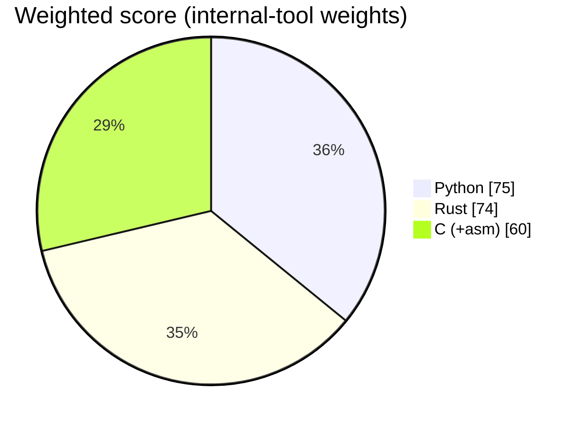

# ADR 0001 — Implementation language: Python (Profile B)

- Status: accepted
- Date: 2026-10-19
- Deciders: Rakvor engineering (language council: Rust, Python and C/assembly advocates + rebuttal round)

## Context

This build of RV HashInv is an **internal** tool: examiners run it on Rakvor laptops, it changes often, and future
analyzers will reuse Python forensic libraries (libyal bindings, pytsk3, dfvfs). It still needs a CLI and a GUI on
Windows 10/11 and the same audit/report contract as the client-facing Rust build.

## Options scored (1–5, weighted for an internal, fast-changing tool)

| Criterion | Weight | Rust | Python | C (+asm) |
| --- | :-: | :-: | :-: | :-: |
| Speed (hashlib/blake3 are native) | 1 | 5 | 3 | 5 |
| Transferability (Win10/11, Linux) | 1 | 5 | 4 | 3 |
| Storage (installer size) | 1 | 4 | 2 | 5 |
| Hardware / RAM | 1 | 5 | 3 | 5 |
| Windows GUI maturity | 2 | 4 | 4 | 2 |
| CLI help quality | 2 | 5 | 5 | 2 |
| Packaging / antivirus risk | 1 | 4 | 2 | 4 |
| Memory safety / court auditability | 1 | 5 | 3 | 2 |
| Team velocity | 4 | 3 | 5 | 3 |
| DFIR library ecosystem | 4 | 4 | 5 | 4 |
| **Weighted total** (max 90) | | 74 | **75** | 60 |

## Decision

Python 3.11+, click + rich (CLI), PySide6 (GUI), hashlib + blake3, Jinja2 + ReportLab, frozen with Nuitka
(standalone) and installed with Inno Setup. The scores are close: Python wins on the two criteria that matter most
for an internal tool (team velocity, DFIR libraries). With the client/court weights, Rust wins clearly, so
re-evaluate if this tool is ever delivered to clients or its output becomes evidence in court.

## Consequences

- Bigger download (~60–90 MB with Qt) and slower start than Rust.
- Same audit chain, CSV, JSON schemas and report templates as the Rust profile: outputs are interchangeable
  (`rv-hashinv verify-log` of either build verifies logs of the other).
