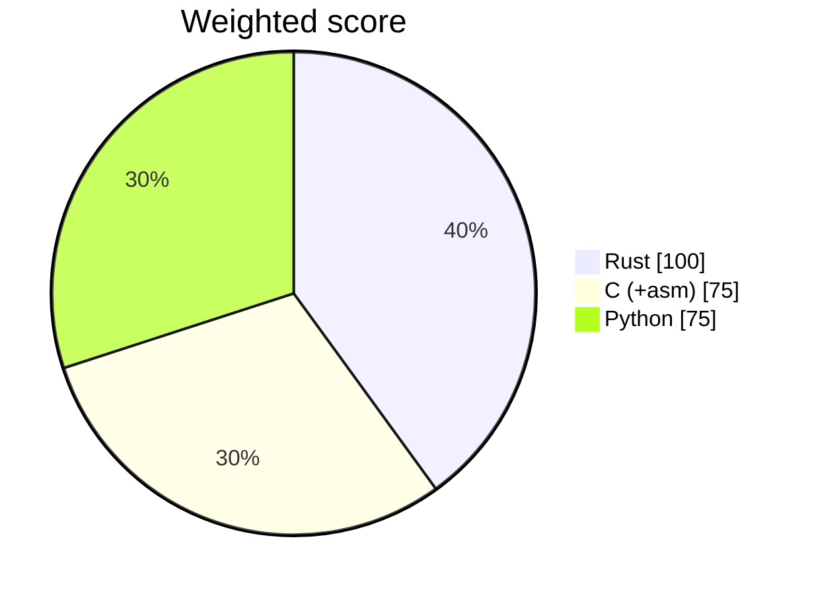

# ADR 0001 — Implementation language: Rust (Profile A)

- Status: accepted
- Date: 2026-10-19
- Deciders: Rakvor engineering (language council: Rust, Python and C/assembly advocates + rebuttal round)

## Context

RV HashInv is delivered to clients and its results may be presented in court in Colombia and France. It must
run as a CLI and a GUI on Windows 10/11 without installing a runtime, hash large evidence sets quickly, and be
easy to audit.

## Options scored (1–5, weighted)

| Criterion | Weight | Rust | Python | C (+asm) |
| --- | :-: | :-: | :-: | :-: |
| Speed (hashing throughput, startup) | 3 | 5 | 3 | 5 |
| Transferability (Win10/11 x64 + ARM64, Linux) | 3 | 5 | 4 | 3 |
| Storage (single small exe) | 2 | 4 | 2 | 5 |
| Hardware / RAM (8 GB laptops, VMs without GPU) | 2 | 5 | 3 | 5 |
| Windows GUI maturity | 2 | 4 | 4 | 2 |
| CLI `--help` quality | 2 | 5 | 5 | 2 |
| Packaging, signing, antivirus false positives | 2 | 4 | 2 | 4 |
| Memory safety / court auditability | 3 | 5 | 3 | 2 |
| Team velocity | 2 | 3 | 5 | 3 |
| CI/CD complexity | 1 | 5 | 3 | 3 |
| **Weighted total** (max 110) | | **100** | 75 | 75 |

## Decision

Rust workspace: `src/core` (library), `src/cli` (clap), `src/gui` (eframe/egui with the wgpu renderer).
No hand-written assembly: the hash crates already use SIMD/CPU intrinsics where available.

## Consequences

- Two static executables, no runtime to install; the same core powers both.
- Contributors need Rust; Python stays the choice for internal, library-heavy tools (Profile B).
- Windows binaries are built on GitHub's `windows-latest` runners.
