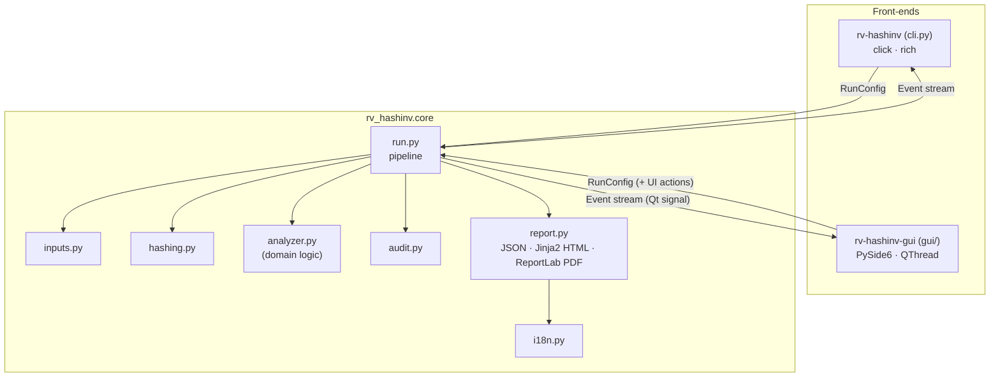
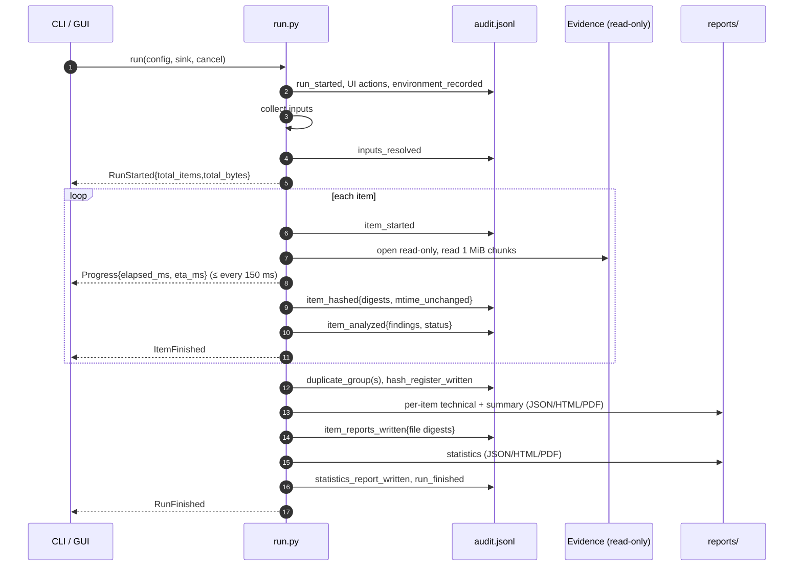
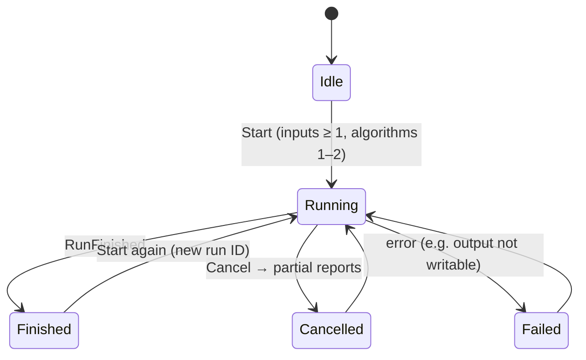

# Architecture

One engine, two front-ends. The engine (`src/rv_hashinv/core`) does all the work and never prints; the CLI and
the GUI only turn user input into a `RunConfig` and render the `Event`s the engine emits. This is why
both interfaces always produce identical logs and reports.

## Modules

| Module | Responsibility | Replace when building a new tool? |
| --- | --- | --- |
| `inputs.py` | Files, folders, list files → sorted, de-duplicated, absolute paths. Symlinks not followed. | No |
| `hashing.py` | One read loop (1 MiB chunks) feeding 1–2 digests; known-answer self-test. | No |
| `analyzer.py` | Signature detection and per-item findings. | **Yes — this is the domain logic** |
| `audit.py` | Append-only hash-chained `audit.jsonl` + `audit.log`; `verify`. | No |
| `report.py` | View models → Jinja2 HTML, ReportLab PDF, schema-versioned JSON. | Adapt wording/fields |
| `events.py` | Event dicts (same JSON as the Rust profile); ETA computation. | No |
| `envinfo.py` | `environment.json` (versions, OS, host, user, command line). | No |
| `run.py` | Orchestration, cancellation, duplicates, `hashes.csv`. | Small changes |

## One run, step by step

## Run states (as the GUI sees them)

## Concurrency and cancellation

- The GUI runs the engine on a `QThread` and receives events as Qt signals, so the window stays
  responsive; the elapsed-time label is refreshed every 200 ms by a `QTimer`.
- Cancellation is a `threading.Event` checked after every 1 MiB chunk: large images stop within milliseconds.
  The engine still writes `hashes.csv`, partial reports and `run_cancelled` to the audit log.
- Files are processed sequentially on purpose: the order of audit entries equals the order of work, which is
  easier to explain in court. `hashlib` and `blake3` release the GIL and run at native speed; hashing is
  I/O-bound on typical evidence drives.

## Why Python

See [ADR 0001](adr/0001-language.md).
