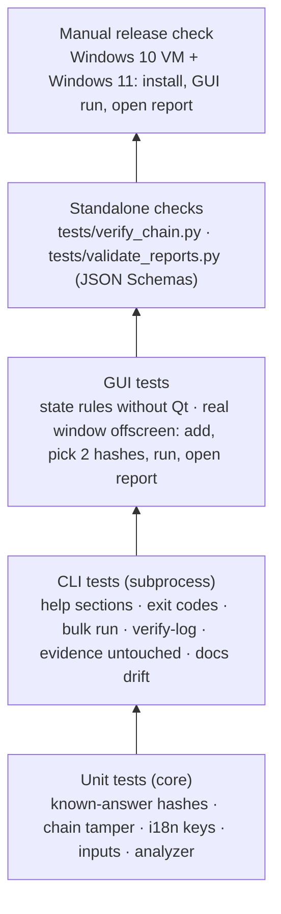
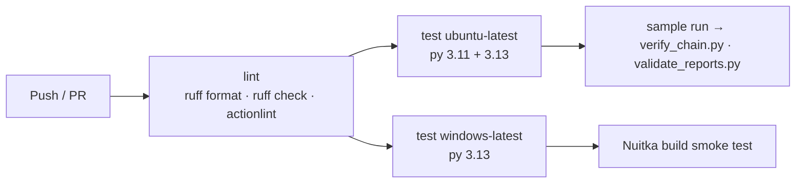
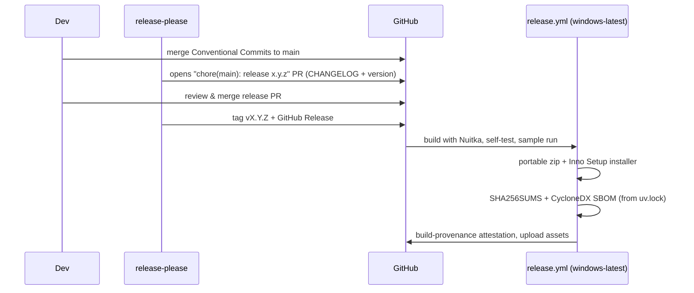

# Development, CI/CD and releases

## Build and test locally

```bash
uv sync --extra gui                         # .venv from uv.lock (hashes pinned)
uv run pytest                               # core, CLI (subprocess), GUI state, GUI window (offscreen)
uv run ruff format --check src tests && uv run ruff check src tests
uv run rv-hashinv scan -i examples/sample/evidence --lang all
uv run rv-hashinv-gui
```

GUI tests set `QT_QPA_PLATFORM=offscreen` (see `tests/conftest.py`), so they run in CI without a display.

## Test pyramid



## Continuous integration



## Freezing for Windows (Nuitka)

`packaging/build_windows.py` compiles both entry points with Nuitka in **standalone** (folder) mode:

| Output | Why |
| --- | --- |
| `dist/rv-hashinv/rv-hashinv.exe` (console) and `rv-hashinv-gui.exe` (no console) | One folder, shared runtime |
| Standalone, not onefile | Onefile unpacks to `%TEMP%` at every start: slower and a classic antivirus false positive |
| PySide6 as separate DLLs | LGPL-3.0 compliance: users can replace the Qt libraries |

## Releasing



> One-time repository setting for release-please: *Settings → Actions → General → Workflow permissions →
> Allow GitHub Actions to create and approve pull requests*.

### Code signing

| Option | Notes |
| --- | --- |
| Azure Artifact Signing (Trusted Signing) | Low cost, GitHub Actions integration; eligible for the French entity, not currently for the Colombian one. |
| OV code-signing certificate (HSM/cloud key) | Works for either entity. |

### Release checklist (manual)

- [ ] `rv-hashinv self-test` on the released exe passes on Windows 10 **and** Windows 11
- [ ] GUI opens, runs the sample, *Open report* works
- [ ] `SHA256SUMS` matches; `gh attestation verify` passes
- [ ] CHANGELOG entry reviewed by a human
