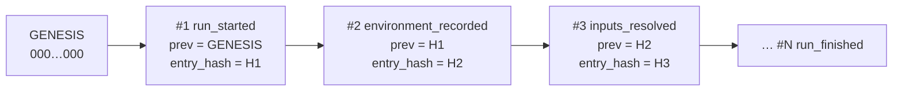
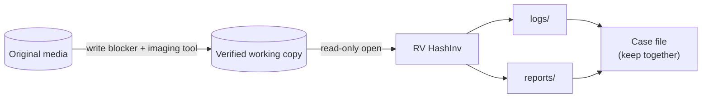

# Forensic audit trail

Everything RV HashInv does is written to `<OUT>/logs/<RUN-ID>/`. The folder is designed so that a second
examiner, months later, can check **what was done, to which files, by whom, with which tool version**, and
that the record was not altered.

| File | Content |
| --- | --- |
| `audit.jsonl` | One JSON object per action, hash-chained (authoritative) |
| `audit.log` | The same actions as readable text (convenience copy) |
| `hashes.csv` | Hash register: `index,path,size,<algo1>[,<algo2>],status,error` |
| `environment.json` | Tool version, compiler, target, every dependency version, OS, host, OS user, working folder, command line |

## The hash chain



Each entry has: `seq`, `ts_utc`, `run_id`, `actor`, `action`, optional `item`, `details`,
`prev_entry_hash`, `entry_hash`.

```text
entry_hash = SHA-256( canonical JSON of the entry without "entry_hash" )
canonical  = keys sorted at every level, no spaces, UTF-8, integers only
             (Python: json.dumps(e, sort_keys=True, separators=(",", ":"), ensure_ascii=False))
```

Editing a value changes that entry's hash; deleting or re-ordering breaks `seq` and `prev_entry_hash`.
Verify with either implementation:

```bash
rv-hashinv verify-log rakvor-out/logs/<RUN-ID>          # exit 0 intact, 3 broken
python tests/verify_chain.py rakvor-out/logs/<RUN-ID>   # independent re-implementation
```

> The chain proves the log is **internally consistent**. It does not prove *when* it was written. For that,
> store the final `entry_hash` (printed in the statistics report) somewhere independent — case management
> system, e-mail to the client, or an RFC 3161 timestamp — at the end of the run.

## Actions recorded

| Action | When | Key details |
| --- | --- | --- |
| `run_started` | first | tool, version, frontend, algorithms, langs, inputs, case |
| `ui_*` | GUI only, before the run | input added/removed, hash selection, language, recursive, start clicked |
| `environment_recorded` | | digests of `environment.json` |
| `inputs_resolved` | | number of items and bytes |
| `item_started` | each item | index, size, modified time |
| `item_hashed` | each item | digests, bytes read, `mtime_unchanged` |
| `item_error` | unreadable item | error message |
| `item_analyzed` | each item | detected type, extension, findings, status |
| `item_cancelled` / `run_cancelled` | on cancel | processed count |
| `duplicate_group` | after the loop | hash, item indexes |
| `hash_register_written` | | digests of `hashes.csv` |
| `item_reports_written` | each item | digests of every report file |
| `statistics_report_written` | | digests of statistics files |
| `run_finished` / `run_failed` | last | totals, severities, elapsed |

## Evidence handling



- Files are opened with read-only access; modification times are compared before and after hashing
  (`mtime_unchanged` in `item_hashed`).
- Symbolic links are never followed (no escape outside the selected folders).
- The tool does not replace imaging tools or write blockers: run it on a verified copy.

## Mapping to ISO/IEC 27037:2012

| 27037 principle / activity | How RV HashInv supports it |
| --- | --- |
| Auditability (5.3.3) | Every action logged with actor, UTC time and chain hash |
| Repeatability (5.3.3) | `environment.json` records exact tool and dependency versions; same input → same hashes |
| Reproducibility | Independent verifier (`tests/verify_chain.py`) and standard algorithms |
| Justifiability | Every finding states what it shows and what it does **not** prove; limitations in every report |
| Preservation (7.1.4) | Read-only access; hashes of every file and of every report produced |
| Documentation / chain of custody | Hash register, reports, and log folder form the record of the examination |

Colombian practice (Ley 906 de 2004, Manual de cadena de custodia) and French practice (Code de procédure
pénale, art. 156 ff. for expertise) both expect the examiner to document the method and preserve integrity;
the log folder plus the reports are that documentation for this step of the examination.
