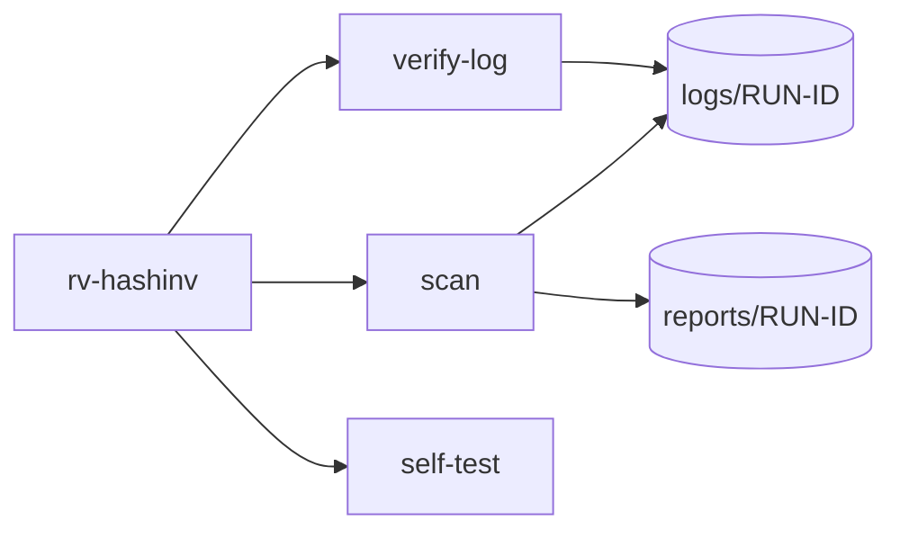

# Command-line reference

<!-- Generated by `rv-hashinv docs-cli`. Do not edit by hand: CI fails if this file differs. -->



## rv-hashinv

```text
DESCRIPTION:
  rv-hashinv reviews a single file, a whole folder (bulk) or a list of files. For every file it:
    1. opens the file read-only and hashes it in one pass with one or two algorithms;
    2. detects the real file type from its signature (magic bytes);
    3. flags empty files, extensions that do not match the content, programs hidden under
       another name and duplicated content;
    4. writes a technical report and a customer-friendly summary (HTML, PDF and JSON).
  Each run also writes a statistics report and an audit trail under <OUT>/logs/<RUN-ID>/.
  Every action is appended to a hash-chained log that `rv-hashinv verify-log` can check later.

Usage: rv-hashinv <COMMAND>

Commands:
  scan        Hash, check and report on a file, a folder or a list of files
  verify-log  Verify that an audit log (audit.jsonl) has not been edited, truncated or re-ordered
  self-test   Check every hash algorithm against known-answer test vectors
  help        Print this message or the help of the given subcommand(s)

Options:
  -h, --help
          Print help (see a summary with '-h')

  -V, --version
          Print version

Run `rv-hashinv <COMMAND> --help` for the options, examples and exit codes of each command.
```

## rv-hashinv scan

```text
DESCRIPTION:
  rv-hashinv reviews a single file, a whole folder (bulk) or a list of files. For every file it:
    1. opens the file read-only and hashes it in one pass with one or two algorithms;
    2. detects the real file type from its signature (magic bytes);
    3. flags empty files, extensions that do not match the content, programs hidden under
       another name and duplicated content;
    4. writes a technical report and a customer-friendly summary (HTML, PDF and JSON).
  Each run also writes a statistics report and an audit trail under <OUT>/logs/<RUN-ID>/.
  Every action is appended to a hash-chained log that `rv-hashinv verify-log` can check later.

Usage: rv-hashinv scan [OPTIONS]

Options:
  -i, --input <PATH>
          File or folder to review. Repeat for several.
          
          Folders are reviewed one level deep unless --recursive is given. Symbolic links are not
          followed.
          Default: none (required unless --input-list is given).
          Example: --input D:\evidence --input E:\phone-export\chat.txt

  -L, --input-list <FILE>
          Text file with one path per line (bulk review). Lines starting with # are ignored.
          
          Relative paths are resolved from the list file's folder.
          Default: none. Example: --input-list case-014-files.txt

  -r, --recursive
          Also review files in subfolders.
          
          Default: off (only the first level of each folder). Example: -i D:\evidence --recursive

  -H, --hash <ALGO>
          Hash algorithm(s): one or two of md5, sha1, sha256, sha512, sha3-256, blake3.
          
          Both are computed in the same read of each file. More than two is refused (exit code 2).
          Default: sha256. Example: --hash sha256,md5   or   --hash sha256 --hash blake3

  -o, --out <DIR>
          Folder where logs/ and reports/ are created. Created if missing.
          
          Default: ./rakvor-out. Example: --out E:\case-014\rv-hashinv

  -l, --lang <LANG>
          Report language: en, es, fr, or all (one HTML and PDF per language). JSON is
          language-neutral.
          
          Default: en. Example: --lang es   or   --lang all

  -a, --actor <NAME>
          Name of the examiner, written in every audit entry and report.
          
          Default: the operating-system user name. Example: --actor "Ana Ruiz"

  -c, --case <ID>
          Case or engagement identifier printed on the reports.
          
          Default: none. Example: --case CASE-2026-014

  -p, --progress <MODE>
          How progress is shown: bar, jsonl or none.
          
          Default: bar (hidden automatically when stderr is not a terminal).
          Example: --progress jsonl

          Possible values:
          - bar:   Progress bar with elapsed time, throughput and ETA on stderr
          - jsonl: One JSON event per line on stdout (for scripts and other tools)
          - none:  No progress output; only the final summary

  -h, --help
          Print help (see a summary with '-h')

EXAMPLES:
  Review one file (SHA-256, English reports):
    rv-hashinv scan --input evidence/contract.pdf
  Review a folder and its subfolders with SHA-256 + MD5, Spanish reports, for case CASE-2026-014:
    rv-hashinv scan -i D:\evidence -r --hash sha256,md5 --lang es --case CASE-2026-014
  Review the files listed in a text file, reports in the three languages, machine-readable progress:
    rv-hashinv scan --input-list files.txt --lang all --progress jsonl > events.jsonl
  Verify the audit log afterwards:
    rv-hashinv verify-log rakvor-out/logs/<RUN-ID>/audit.jsonl

EXIT CODES:
  0    Completed; no high-severity finding.
  1    Runtime error (input not found, output not writable, ...). See the audit log.
  2    Usage error (unknown option, more than two hash algorithms, unsupported language).
  3    Completed with at least one high-severity finding (e.g. unreadable file, program under
  another name).
  130  Cancelled with Ctrl+C. Partial reports and the cancellation are written to the audit log.

FILES WRITTEN:
  <OUT>/logs/<RUN-ID>/audit.jsonl         Hash-chained log of every action (one JSON object per
  line).
  <OUT>/logs/<RUN-ID>/audit.log           The same actions, human-readable.
  <OUT>/logs/<RUN-ID>/hashes.csv          Hash register: index, path, size, digests, status.
  <OUT>/logs/<RUN-ID>/environment.json    Tool and dependency versions, OS, host, user, command
  line.
  <OUT>/reports/<RUN-ID>/statistics.json  Run statistics (+ statistics.<LANG>.html and .pdf).
  <OUT>/reports/<RUN-ID>/items/<NNNNN>-<NAME>/technical.json|.<LANG>.html|.<LANG>.pdf   Technical
  review.
  <OUT>/reports/<RUN-ID>/items/<NNNNN>-<NAME>/summary.json|.<LANG>.html|.<LANG>.pdf     Customer
  summary.

FORENSIC NOTES:
  - Evidence is opened read-only and never modified; modification times are compared before and
  after.
  - Work on a verified copy (write-blocked image or export), not on original media.
  - Each audit entry stores the SHA-256 of the previous one; editing, deleting or re-ordering any
    line is detected by `verify-log`. Keep the log folder with the reports.
  - A file without findings is not proven authentic; read the Limitations section of each report.
  - MD5 and SHA-1 are accepted for compatibility with older case files; pair them with SHA-256 or
  BLAKE3.
```

## rv-hashinv verify-log

```text
Verify that an audit log (audit.jsonl) has not been edited, truncated or re-ordered

Usage: rv-hashinv verify-log <LOG>

Arguments:
  <LOG>
          Path to audit.jsonl, or to the run's log folder that contains it.
          
          Example: rakvor-out/logs/20261019T101500Z-a1b2c3

Options:
  -h, --help
          Print help (see a summary with '-h')

EXAMPLES:
  rv-hashinv verify-log rakvor-out/logs/20261019T101500Z-a1b2c3/audit.jsonl
  rv-hashinv verify-log rakvor-out/logs/20261019T101500Z-a1b2c3

EXIT CODES:
  0  The chain is intact.
  1  The log cannot be read.
  3  The chain is broken: at least one entry was edited, deleted or re-ordered.
```

## rv-hashinv self-test

```text
Check every hash algorithm against known-answer test vectors

Usage: rv-hashinv self-test

Options:
  -h, --help
          Print help (see a summary with '-h')

EXAMPLES:
  rv-hashinv self-test

EXIT CODES:
  0  All algorithms give the published answer for the input "abc".
  1  At least one algorithm failed: do not use this build for evidence.
```

